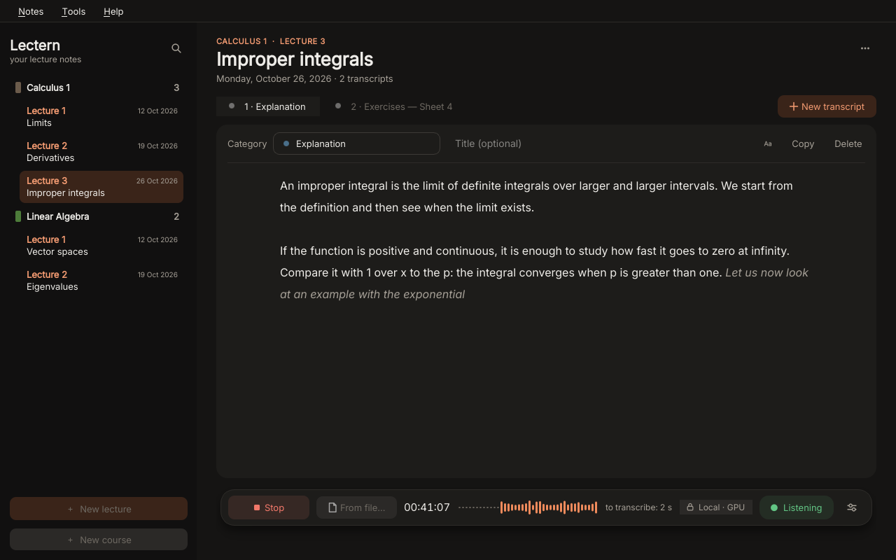
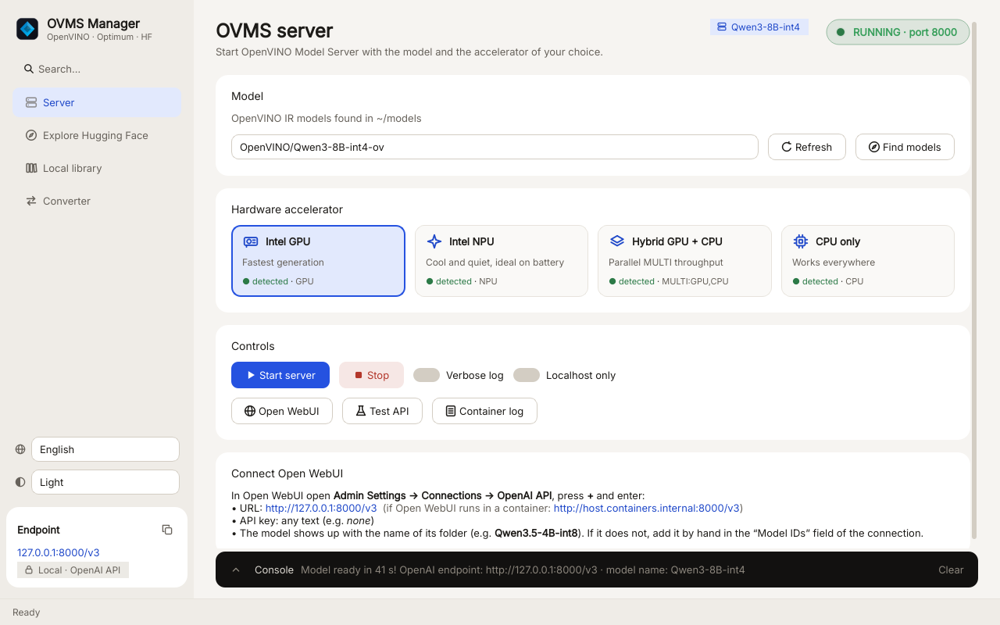

# Local AI apps for OpenVINO

[](https://github.com/VarCode-ai/ai-app-local-openvino/actions/workflows/checks.yml)
[](LICENSE)
[](https://github.com/VarCode-ai/ai-app-local-openvino/releases)

Desktop apps for Linux that run AI models **entirely on your own computer** with
[Intel OpenVINO](https://github.com/openvinotoolkit/openvino): no cloud services, no accounts, and your
audio and text never leave the machine.

> 🔒 **Private by design**: no cloud, no accounts, no telemetry, and it works offline.
>
> 🧡 **Free and open source**: GPL-3.0, built only on open source software, and every privacy claim can be
> checked in the code. [Read how →](#open-source-and-private-by-design)

## Why this project

Recent Intel processors include an NPU (the *AI Boost* in Core Ultra chips) and a capable integrated GPU,
and OpenVINO can run modern AI models on both. Using them, though, still means working in the terminal:
installing drivers and runtimes, converting models, and writing code against the OpenVINO APIs.

This project started to make the NPU and OpenVINO **easy to use from a graphical interface**: you
install an app, pick a model and an accelerator, and start working.

It is also meant to grow into an **ecosystem of AI apps** built on the same architecture:

- **OpenVINO** runs every model locally, on the CPU, the GPU or the NPU.
- **Shared models**: all apps use one models folder (`~/models`), so a model downloaded once is available
  to every app.
- **OVMS Manager** is the common hub to find, download, convert and serve models.
- Every app is a **PySide6 desktop app** with a per-user installer that needs no root access.

**Lectern** is the first app of the ecosystem. More apps, all based on AI, will follow.

## Open source and private by design

AI assistants usually work by sending your voice, your documents and your questions to someone else's
servers. These apps take the opposite approach: **the AI comes to your computer, your data does not go
anywhere.**

### Private by design

- **Everything runs locally.** Lectern transcribes your microphone and files on your CPU, GPU or NPU.
  The models served by OVMS Manager answer from your own machine. Recordings, transcripts, prompts and
  answers never leave your computer.
- **No accounts, no API keys, no subscriptions.** There is nothing to sign up for, and no usage limit
  other than your hardware.
- **No telemetry.** The apps collect no usage statistics, analytics or crash reports. They also switch off
  the optional usage statistics of the libraries they run: Hugging Face downloads
  (`HF_HUB_DISABLE_TELEMETRY`, `DO_NOT_TRACK`) and OpenVINO's model conversion in the Converter.
- **Works offline.** Once the models are downloaded, transcription and inference need no connection at
  all.
- **Your data stays yours.** Notes are plain text files in folders you choose: no database, no
  proprietary format, no lock-in. Uninstalling an app never deletes your notes, models or settings.
- **Recordings are local too.** If you choose to save the audio of a lecture, it is a `.wav` file in the
  lecture folder, nowhere else.

#### Every network connection, listed

The apps connect to the internet only in these cases. Each request reveals your IP address and a software
name, as any HTTP request does; none of them carries your audio, your text or anything that identifies you.

| When | Where | What for | What is sent | Can you avoid it? |
| --- | --- | --- | --- | --- |
| You open *Explore Hugging Face* (OVMS Manager) | huggingface.co | List of OpenVINO models | Your search text, if any | Yes: the catalog is cached for 6 hours and offline the cache is used |
| You download a model | huggingface.co | Model files | The model name | No: it is the download you asked for |
| You start the server or download for the first time | docker.io | The OpenVINO Model Server container image | The image name | No, but only once |
| First recording in Lectern | raw.githubusercontent.com | Silero voice detection model (1.3 MB) | Nothing | Yes: offline, Lectern uses a simpler volume-based detection |
| At most once a day | api.github.com | Is there a newer release? | Nothing | Yes: **Help → Check for updates automatically** in Lectern, the command palette in OVMS Manager |
| You run the Converter | huggingface.co | The original model to convert | The model name | No: it is the conversion you asked for |

Buttons such as *Open on Hugging Face* or *Open WebUI* simply open your web browser.

### Free and open source

- **GPL-3.0-or-later.** You are free to use the apps for any purpose, study how they work, change them and
  share them. Copyleft guarantees that every version based on this code stays free and open as well: these
  apps can never be turned into a closed product.
- **Open from top to bottom.** The apps depend only on open source software: OpenVINO and OpenVINO Model
  Server (Apache 2.0), Qt for Python (LGPL), Silero VAD (MIT), and the Inter and Newsreader fonts (OFL).
  The Whisper models are open-weight (MIT).
- **Verifiable, not just promised.** Every claim on this page can be checked in a few files:
  - [`common/ui_kit.py`](common/ui_kit.py), `UpdateChecker`: the update check;
  - [`ovms-manager/ovms_manager.py`](ovms-manager/ovms_manager.py), `hf_get` and `NO_TELEMETRY_ENV`: the
    catalog and the conversion;
  - [`lectern/lectern.py`](lectern/lectern.py), `SileroVAD`: the voice detection download;
  - [`lectern/transcribe.py`](lectern/transcribe.py), `resolve_model`: the model download.
- **Built in the open.** Every change runs the public checks in GitHub Actions. Issues, translations and pull
  requests are welcome: see [CONTRIBUTING.md](CONTRIBUTING.md).

## Apps

| App | What it does |
| --- | --- |
| [**OVMS Manager**](ovms-manager/README.md) | A graphical front end for [OpenVINO Model Server](https://github.com/openvinotoolkit/model_server) (OVMS). Browse the ready-to-use OpenVINO models on Hugging Face, download them, serve them through an OpenAI-compatible API (for example to chat in [Open WebUI](https://github.com/open-webui/open-webui)), and convert other models with Optimum. |
| [**Lectern**](lectern/README.md) | A lecture notebook with live speech-to-text. It records from the microphone and transcribes in real time with Whisper, organizing the text by course, lecture and category. It can also transcribe audio files you have already recorded. |
| [**lectern-transcribe**](lectern/README.md#batch-transcription-lectern-transcribe) | A command-line tool, installed with Lectern, that transcribes every audio or video file in a folder. |

<p align="center">
  
  
</p>
<p align="center">
  
  
</p>

Both apps work on any recent x86-64 CPU and run faster on Intel hardware: integrated graphics,
Intel Arc GPUs and the NPU of Intel Core Ultra processors.

### Languages

The apps are available in **English** and **Italian**. They follow the language of your system, and you
can choose another one from the app: **Tools → Interface language** in Lectern, the 🌐 menu in the
sidebar of OVMS Manager. The change applies the next time you start the app.

Translations are plain JSON files in each app's `locale/` folder, so adding a language does not need any
tool: see [CONTRIBUTING.md](CONTRIBUTING.md#translations).

### Design

The interface follows the direction designers and product teams set for 2026–2027: calm, local, accessible.

- **Light and dark theme** that follow the system and switch live. You can force either one: **Tools →
  Appearance** in Lectern, the theme menu in the sidebar of OVMS Manager.
- **Calm layout**: warm neutral colors, a sidebar that recedes, few borders. Depth is used only for what
  floats, such as Lectern's recorder dock and the command palette.
- **Command palette** (**Ctrl+K**) in both apps: every action, every lecture and every local model is one
  search away.
- **Visible provenance**: Lectern shows where the transcription runs (*Local · GPU*, updated if it falls back
  to the CPU), and a live waveform shows when it hears speech. OVMS Manager tells you whether a model fits in
  your RAM before you download it.
- **Typography**: [Inter](https://rsms.me/inter/) for the interface, with tabular figures for clocks and
  tables, and [Newsreader](https://github.com/productiontype/Newsreader) as an optional serif for reading
  transcripts. Both fonts are bundled, so the apps look the same on every distribution.
- **Accessibility**: every text and focus color reaches the WCAG 2.2 AA contrast ratios in both themes
  (checked by `tools/check_contrast.py`), focus rings are visible, and **Reduce motion** turns off the
  animations. It follows GNOME's setting by default.

## Requirements

- **Linux on x86-64** with glibc: Ubuntu 22.04+, Debian 12+, Fedora 39+, Arch Linux, openSUSE
  Tumbleweed, Linux Mint, Pop!_OS and their derivatives. openSUSE Leap 15.6 works with the `python311`
  package and `PYTHON=python3.11` (its default `python3` is too old). Distributions based on musl
  (Alpine) are not supported, because PySide6 and OpenVINO only publish glibc wheels.
- **Python 3.10 or newer** with the `venv` module.
- A desktop session (Wayland or X11).
- **OVMS Manager** also needs [Podman](https://podman.io) or [Docker](https://docs.docker.com/engine/install/) to run the model server.
- **Lectern** also needs `ffmpeg` to read files other than `.wav`.

Optional, for hardware acceleration:

- **Intel GPU** (integrated UHD/Iris Xe graphics or Arc). OVMS Manager needs nothing extra, since the
  container image ships its own GPU driver. Lectern runs Whisper directly on your system, so it needs the
  Intel compute runtime on the host (see the table below).
- **Intel NPU** (Core Ultra processors). Needs the
  [Linux NPU driver](https://github.com/intel/linux-npu-driver) and a recent kernel.

### System packages by distribution

The installers check for missing packages and print the right command for your system. To install
everything up front, use the command for your distribution:

| Distribution | Base packages | Intel GPU runtime (for Lectern) |
| --- | --- | --- |
| Ubuntu, Debian, Mint | `sudo apt install python3 python3-venv ffmpeg podman libxcb-cursor0` | `sudo apt install intel-opencl-icd` |
| Fedora | `sudo dnf install python3 ffmpeg-free podman xcb-util-cursor` | `sudo dnf install intel-compute-runtime` |
| Fedora Atomic (Silverblue, Kinoite) | `rpm-ostree install ffmpeg-free xcb-util-cursor` (Python and Podman are preinstalled) | `rpm-ostree install intel-compute-runtime` |
| Arch Linux, Manjaro, EndeavourOS | `sudo pacman -S python ffmpeg podman xcb-util-cursor` | `sudo pacman -S intel-compute-runtime` |
| openSUSE | `sudo zypper install python3 ffmpeg podman libxcb-cursor0` | `sudo zypper install intel-opencl` |

You can replace `podman` with Docker if you already use it. `libxcb-cursor` is only needed on X11
sessions, but installing it costs nothing.

## Quick start

```bash
git clone https://github.com/VarCode-ai/ai-app-local-openvino.git
cd ai-app-local-openvino

./ovms-manager/install.sh   # OVMS Manager
./lectern/install.sh        # Lectern + lectern-transcribe
```

Each installer works only in your home folder and never asks for `sudo`. It creates a private Python
environment, adds the app to the application menu and adds a command to `~/.local/bin`. Once the
installation is done you can move or delete the cloned folder. To update, pull the repository and run the
installer again.

| Command | Effect |
| --- | --- |
| `./ovms-manager/install.sh --with-optimum` | Also installs optimum-intel and a CPU-only PyTorch (a few GB), needed by the Converter page. |
| `./<app>/install.sh --dev` | Development mode: the menu entry runs the files in your clone instead of a copy. |
| `./<app>/install.sh --uninstall` | Removes the app. Your models, notes and settings are kept. |
| `PYTHON=python3.12 ./<app>/install.sh` | Uses a specific Python, for example when OpenVINO has no wheels yet for your distribution's newest Python. |

### Updating

When a new version is published, both apps show a banner with a link to the release notes. You can also
check by hand: **Help → Check for updates** in Lectern, *Check for updates* in the command palette (Ctrl+K)
of OVMS Manager. To update, get the new version and run the installers again: your models, notes and settings
are kept.

```bash
cd ai-app-local-openvino
git pull
./ovms-manager/install.sh
./lectern/install.sh
```

Without git, download the source archive of the latest release from the
[Releases page](https://github.com/VarCode-ai/ai-app-local-openvino/releases), extract it and run the
two installers.

### Your first model

1. Open **OVMS Manager → Explore Hugging Face**.
2. For chat, pick an `INT4` model that fits your memory (for example `Qwen3-8B-int4-ov`) and press
   **Download with OVMS**.
3. For Lectern, choose the *Speech-to-Text* type and download `whisper-large-v3-turbo-int8-ov`.
   `lectern-transcribe` can also download it for you on first use.

Models are stored in `~/models`, a folder shared by both apps.

## Configuration

| Variable | Default | Used by | Meaning |
| --- | --- | --- | --- |
| `OPENVINO_MODELS_DIR` | `~/models` | both | Folder holding the OpenVINO models. |
| `OVMS_CONTAINER_RUNTIME` | auto (`podman`, then `docker`) | OVMS Manager | Forces the container runtime. |
| `OVMS_EXTRA_RUN_ARGS` | empty | OVMS Manager | Extra options for every container, e.g. `--group-add keep-groups`. |
| `OPEN_WEBUI_URL` | `http://localhost:3000` | OVMS Manager | Address opened by the *Open WebUI* button. |
| `PYTHON` | `python3` | installers | Interpreter used to create the environments. |

The apps follow the XDG base directories: settings go in `~/.config`, caches and logs in `~/.cache`, and
the installed apps in `~/.local/share`.

## Security notes

Privacy is covered in [Open source and private by design](#open-source-and-private-by-design). A few
things to keep in mind:

- The OVMS API has **no authentication**. By default the container publishes port 8000 on every network
  interface, so a containerized Open WebUI can reach it. On untrusted networks, enable **Localhost only**
  on the Server page or block the port with your firewall.
- **Allow custom code** (`--trust-remote-code`) in the Converter runs Python code from the model
  repository on your computer. Enable it only for repositories you trust.
- Models come from their authors on Hugging Face. Prefer the official `OpenVINO/` repositories, which
  OVMS Manager marks with ✓.
- To opt out of OpenVINO's usage statistics for every OpenVINO tool on your system, not only inside these
  apps, run `opt_in_out --opt_out` once.

## Repository layout

```
ai-app-local-openvino/
├── ovms-manager/
│   ├── ovms_manager.py      # PySide6 app
│   ├── install.sh           # per-user installer
│   ├── locale/it.json       # Italian translation
│   ├── requirements.txt
│   └── ovms-manager.svg
├── lectern/
│   ├── lectern.py           # PySide6 app (notebook + live transcription)
│   ├── transcribe.py        # batch transcription CLI, also used by lectern.py
│   ├── transcribe.sh        # interactive front end (installed as lectern-transcribe)
│   ├── lectern.sh           # starts Lectern from the clone without installing it
│   ├── install.sh
│   ├── locale/it.json       # Italian translation
│   ├── requirements.txt
│   └── lectern.svg
├── common/                    # shared by every app of the ecosystem
│   ├── ui_kit.py              # design tokens, themes, icons, command palette
│   └── fonts/                 # Inter and Newsreader (SIL Open Font License)
├── tools/
│   ├── check_translations.py  # checks that the translation catalogs are complete
│   └── check_contrast.py      # checks the WCAG contrast of the theme colors
├── .github/workflows/         # continuous integration: lint, translations, contrast
└── docs/
    ├── images/                # screenshots
    └── troubleshooting.md
```

## Troubleshooting

See [docs/troubleshooting.md](docs/troubleshooting.md) for fixes to common problems: Qt failing to start,
Python environment errors, the GPU or NPU not detected, container permissions, and slow transcription.

## Contributing

Bug reports and pull requests are welcome. [CONTRIBUTING.md](CONTRIBUTING.md) explains how to run the
apps from a clone and which checks to run before submitting.

## License

Copyright © 2026 VarCode-ai.

This project is free software, released under the [GNU General Public License v3.0 or later](LICENSE).

It builds on third-party software that keeps its own license: OpenVINO, OpenVINO GenAI and OpenVINO
Model Server (Apache 2.0), Qt for Python / PySide6 (LGPL v3), Silero VAD (MIT), OpenAI Whisper models
(MIT), the Inter and Newsreader fonts (SIL Open Font License 1.1, see `common/fonts/`), and the models you
download, each covered by the license on its Hugging Face page.
