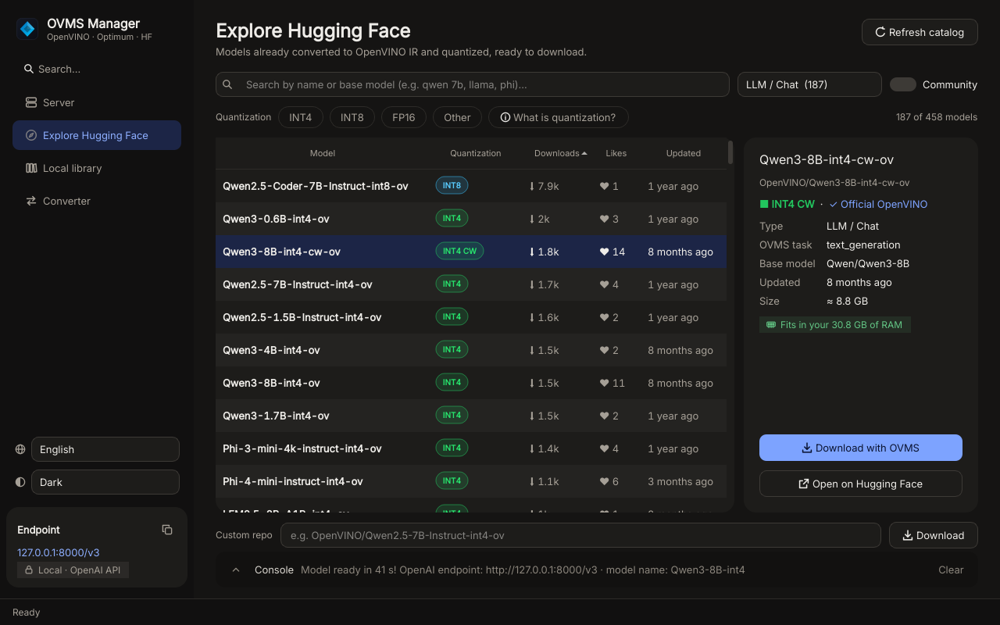

# OVMS Manager



A desktop front end for [OpenVINO Model Server](https://github.com/openvinotoolkit/model_server) (OVMS).
It finds models on Hugging Face, downloads them, and serves them through an OpenAI-compatible API on
your Intel CPU, GPU or NPU. Any OpenAI-compatible client can then use the model, for example
[Open WebUI](https://github.com/open-webui/open-webui).

OVMS runs in a container (Podman or Docker), so you don't have to install it or the GPU drivers on your
system.

## Install

```bash
./install.sh                  # the app (PySide6 + requests, about 200 MB)
./install.sh --with-optimum   # also the Optimum converter (adds a few GB)
```

The installer copies the app to `~/.local/share/ovms-manager/app`, creates a Python environment next to
it, adds **OVMS Manager** to the application menu and the `ovms-manager` command to `~/.local/bin`.
Run `./install.sh --help` for every option, and `./install.sh --uninstall` to remove it.

Requirements: Python 3.10+, and Podman or Docker. See the [main README](../README.md#requirements) for
the packages of each distribution.

The interface is in English or Italian and follows your system language. To change it, use the 🌐 menu at
the bottom of the sidebar, then restart the app.

## The four pages

### Server

Starts OVMS with the model and the accelerator you pick.

- **Model**: every OpenVINO IR model found in `~/models`.
- **Hardware accelerator**:

  | Mode | OpenVINO device | Notes |
  | --- | --- | --- |
  | Intel GPU | `GPU` | Fastest generation. Passes `/dev/dri` to the container. |
  | Intel NPU | `NPU` | Low power, ideal on battery. Needs the NPU driver on the host. Prefer `INT4 CW` models. |
  | Hybrid GPU + CPU | `MULTI:GPU,CPU` | Splits requests between GPU and CPU. |
  | CPU only | `CPU` | Works on any x86-64 machine. |

  Each card shows whether the hardware was detected. *not Intel · unsupported* means the machine has a
  GPU or NPU from another vendor, which OpenVINO cannot use. *present · /dev not accessible* means the
  app runs in a sandbox (Flatpak, toolbox…) that hides the device.
- **Start server** removes a previous `ovms-server` container, registers the model in
  `~/models/config.json` and starts a new container. Then it follows the container log until the model
  answers, which can take a few minutes the first time.
- **Verbose log** starts OVMS with `--log_level DEBUG`.
- **Localhost only** publishes port 8000 on `127.0.0.1` only, so other computers on your network
  cannot reach the API. Leave it off if Open WebUI runs in a container (see below).
- **Test API** behaves like a client: it lists the models and sends a short chat request.
- **Container log** shows the last 80 lines of the server log.
- The chip next to the status shows the model the server is exposing.
- The **console** at the bottom stays folded to a single line with the latest message; click the arrow to
  open it. It opens by itself when an error arrives.

### Explore Hugging Face

The catalog of models published by the [OpenVINO organization](https://huggingface.co/OpenVINO),
already converted and quantized. It is cached for 6 hours.

- Filter by type (LLM, vision-language, embeddings, rerank, image generation, speech-to-text,
  text-to-speech) and by quantization (`INT4`, `INT8`, `FP16`, other). The **What is quantization?**
  button explains the differences.
- **Community** adds repositories from other authors tagged `openvino`.
- The details panel tells you at a glance whether the model **fits in your RAM** (green), is tight (amber)
  or is larger than your memory (red), from the size of the repository.
- **Download with OVMS** runs `ovms --pull` in a container, which downloads the model into `~/models` and
  prepares it for serving. *Custom repo* accepts any `author/name` repository id.

### Local library

The models in `~/models`, with their size on disk. **Use in server** selects one on the Server page.
**Delete** removes a model folder. If the files were created by the container with a different user ID,
OVMS Manager deletes them through `podman unshare` or a short-lived container.

### Converter

Exports a PyTorch model from Hugging Face to OpenVINO IR with
[optimum-intel](https://github.com/huggingface/optimum-intel), compressing the weights to `INT4`,
`INT8` or `FP16`. It needs `optimum-cli`, installed by `./install.sh --with-optimum`. OVMS Manager also
finds `optimum-cli` if it is installed in the app's own environment or on your `PATH`.

Some models with new architectures need **Allow custom code** (`--trust-remote-code`), which runs Python
code from the repository on your computer. Enable it only for repositories you trust.

## Command palette and appearance

- **Ctrl+K**, or **Search…** at the top of the sidebar, opens the command palette. Go to a page, start or
  stop the server, test the API, use any local model, or type a name and choose *Search the catalog*.
- The two menus at the bottom of the sidebar set the interface language and the theme (*System*, *Light*,
  *Dark*). The theme changes immediately; *System* follows the desktop.
- When a new version is released, a banner at the top links to its notes. In the command palette,
  *Check for updates* checks right away and *Turn automatic update checks off* disables the daily check.

## Connect Open WebUI

In Open WebUI open **Admin Settings → Connections → OpenAI API**, press **+** and enter:

- **URL**: `http://127.0.0.1:8000/v3` if Open WebUI runs directly on your system.
  If it runs in a container, use `http://host.containers.internal:8000/v3` with Podman or
  `http://host.docker.internal:8000/v3` with Docker.
- **API key**: any text, for example `none`.

The model shows up with the name of its folder without the `-ov` suffix (for example
`Qwen3-8B-int4`). If it doesn't, add that name to the **Model IDs** field of the connection.

To run Open WebUI in a container:

```bash
# Podman
podman run -d --name open-webui -p 3000:8080 -v open-webui:/app/backend/data \
    ghcr.io/open-webui/open-webui:main

# Docker: host.docker.internal must be mapped explicitly on Linux
docker run -d --name open-webui -p 3000:8080 -v open-webui:/app/backend/data \
    --add-host=host.docker.internal:host-gateway ghcr.io/open-webui/open-webui:main
```

## Container runtime

OVMS Manager uses Podman if it is installed, otherwise Docker. To force one, set
`OVMS_CONTAINER_RUNTIME=docker` (or `podman`). `OVMS_EXTRA_RUN_ARGS` adds options to every
`podman run`/`docker run`, for example `OVMS_EXTRA_RUN_ARGS="--group-add keep-groups"`.

- **Podman (rootless)** is the recommended runtime. Files written by the container in `~/models` belong
  to a sub-UID of your user.
- **Docker** runs the containers with your user and group IDs (`--user`) and adds the groups that own
  `/dev/dri` and `/dev/accel` (`--group-add`), so the files it writes belong to you. Your user must be
  allowed to use Docker: either it is in the `docker` group or you use rootless Docker.

Volumes are mounted with the shared SELinux label (`:z`), which on systems without SELinux has no effect.

The image is `docker.io/openvino/model_server:latest-gpu`, about 2 GB. It is downloaded the first time
you download a model or start the server.

## Files

| Path | Content |
| --- | --- |
| `~/models/` (or `$OPENVINO_MODELS_DIR`) | Models, and the `config.json` that OVMS reads. |
| `~/.cache/ovms_manager/hf_catalog.json` | Cached Hugging Face catalog. |
| `~/.cache/ovms_manager/state.json` | Last served model name, the *Localhost only* setting and the interface language. |
| `~/.local/share/ovms-manager/` | Installed app and Python environments. |

## Troubleshooting

| Problem | Fix |
| --- | --- |
| The status pill shows *Podman/Docker missing* | Install Podman or Docker (see the main README). |
| The status pill shows *Docker error* | Your user cannot use Docker. Add it to the `docker` group (`sudo usermod -aG docker $USER`, then log out and back in) or use Podman. |
| The container stops right away | Press **Container log**. Common causes: not enough memory for the model, or a device the model doesn't support (try the CPU mode). |
| GPU mode fails with rootless Podman (`Context was not initialized`, permission denied on `/dev/dri`) | On some distributions the GPU is only accessible through your `render`/`video` group, which rootless containers drop by default. Start OVMS Manager with `OVMS_EXTRA_RUN_ARGS="--group-add keep-groups" ovms-manager` (requires the `crun` runtime, the default on recent distributions). |
| *Model did not become available* | Large models can take more than 10 minutes on the first load. Check the log, then press **Start server** again: later loads are faster. |
| Converter: *optimum-cli not found* | Run `./install.sh --with-optimum` and restart the app. |

More fixes are in [docs/troubleshooting.md](../docs/troubleshooting.md).
